# Firm Manager: user guide

Firm Manager keeps your clients, cases, documents, court dates, tasks and billing **on your own office network**. Nothing is stored
online and nothing is sent to anyone. This guide explains everything, in the order you will need it: how the system fits together,
setting it up, daily use, backups, licences and plans, updates, moving to a new computer and fixing problems.

**Contents**
1 How it works · 2 Before you start · 3 Install the server · 4 Install the clients · 5 First start and the first administrator ·
6 Signing in · 7 Finding your way around · 8 Clients and cases · 9 Documents · 10 Diary and tasks · 11 Billing · 12 Reports and the audit log ·
13 Settings and your own lists · 14 Users and roles · 15 Computers · 16 Backups and restore · 17 Licence and plans · 18 Updating ·
19 Moving the server to a new computer · 20 Coming from the single-computer version · 21 Problems and answers · 22 Safety notes

---

## 1. How it works
Firm Manager has two programs.

* **The server** holds all the firm's data (database, documents, backups) and your **licence**. Install it on **one** computer, the
  *central computer*. It runs quietly in the background and starts by itself when that computer starts. Nobody works in it directly.
* **The client** is the program people use, with the windows and buttons. Install it on **every computer where someone works**,
  including the central computer if someone works there too. Each client connects to the server over your office network.

Everything that matters is decided by the server: who may see what, what your plan allows, how many computers may connect, and the audit
trail. A client only shows what the server returns, so it cannot be used to get around your plan.

**The Free plan works on one computer only**: the server and one client (for example both on the same PC). Paid plans let more computers
connect at the same time (section 17).

## 2. Before you start
1. **Pick the central computer.** An ordinary, reliable office PC is fine. It must be **switched on whenever anyone works**, so do not use a laptop
   that goes home in the evening. It should be backed up (section 16) and kept somewhere safe.
2. **Give it a fixed address.** Other computers find it by its network (IP) address, so the address must not change. Ask whoever looks after your
   network or router to *reserve* an address for this computer (a "DHCP reservation"), or set a fixed one.
3. **All computers must be on the same office network** (the same router or Wi-Fi). Do **not** try to use Firm Manager over the internet.
4. **Keep it off the internet.** Do not open the port on your router and do not put the server on a public Wi-Fi. Section 22 explains why.
5. You need an **administrator** account on Windows (or `sudo` on Linux) to install the server and, on Windows, to let it start with the computer.

## 3. Install the server (once, on the central computer)
### Windows
1. Run **`FirmManagerServer-Setup-….exe`** as administrator and accept the defaults.
2. The installer does four things for you: copies the program, makes it **start with the computer and restart if it stops**, allows the
   server through the Windows firewall **on private networks only** (port 8000), and creates the data folder
   `C:\ProgramData\FirmManager` (database, documents, backups, logs and your licence).
3. When it finishes, a window opens with **the address the other computers must type** and **this server's Computer ID**. Keep it (it is saved as
   `C:\ProgramData\FirmManager\server-info.txt`). If Windows asks whether the network is *Private* or *Public*, choose **Private**. The firewall rule
   does not apply to Public networks.

### Linux (Debian / Ubuntu)
1. Install the package: `sudo apt install ./firmmanager-server_….deb`
2. It starts at once, starts again at every boot and restarts if it stops. Check with `systemctl status firmmanager-server`.
3. If a firewall is active, allow port 8000 **from your office network only**, for example
   `sudo ufw allow from 192.168.0.0/16 to any port 8000 proto tcp` (change the range to match your network).
4. Show the address and Computer ID any time: `firmmanager-server --info`. Data lives in `/var/lib/firmmanager`.

The server needs no screen, no sign-in and no further setup. To check it is running, open `http://ADDRESS:8000/health` in a web browser on any office
computer; you should see `"status":"ok"`.

## 4. Install the clients (on every computer where someone works)
Run **`FirmManager-Setup-….exe`** (Windows) or `sudo apt install ./firmmanager-client_….deb` (Linux) and open **Firm Manager**.
The client stores only the server's address and a random computer ID on that computer. No firm data is kept there.

## 5. First start and the first administrator
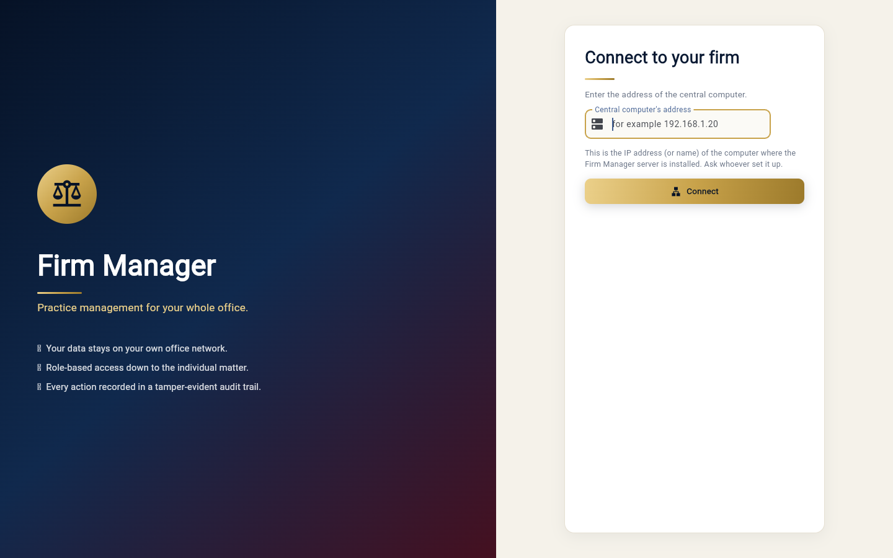

1. **On the central computer**, open Firm Manager. It asks for the server's address. Type **`127.0.0.1`** (this means "this computer") and click **Connect**.
2. Because nobody has an account yet, it asks you to set up the firm and create the **System Administrator**. Choose a password of **at least 12 characters**
   and keep it safe: it cannot be shown again. *This first-time step is only accepted on the central computer itself, so nobody else on the network can take over a new
   installation.*
3. Sign in. Everything works on the **Free plan** until you install a licence.
4. **On every other computer**, open Firm Manager, type the **address from step 3 of the server installation** (for example `192.168.1.20`) and click **Connect**.
   You do not type the port. Then sign in with your own username and password.

To use a different server later, or if the address changed, choose **Use a different server** on the "Cannot reach the server" screen.

## 6. Signing in
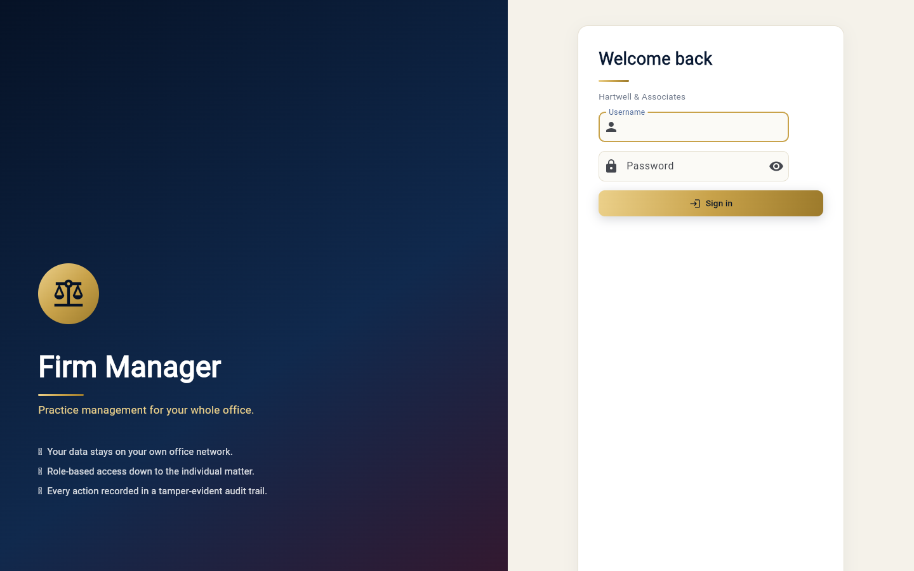

* Everyone has their own username and password. Use your own; the audit log records who did what.
* After **5 wrong passwords** an account is locked for 15 minutes. An administrator can unlock it sooner (section 14).
* A temporary password (given by an administrator) must be changed the first time you use it.
* Change your own password any time with **Password** at the bottom of the menu. **Sign out** is next to it.
* If the server restarts or you are away for a long time you are asked to sign in again. Your work is already saved on the server.

## 7. Finding your way around
The menu on the left lists the pages **your role** may open; colleagues may see a different menu. The **Dashboard** shows what needs attention for you.

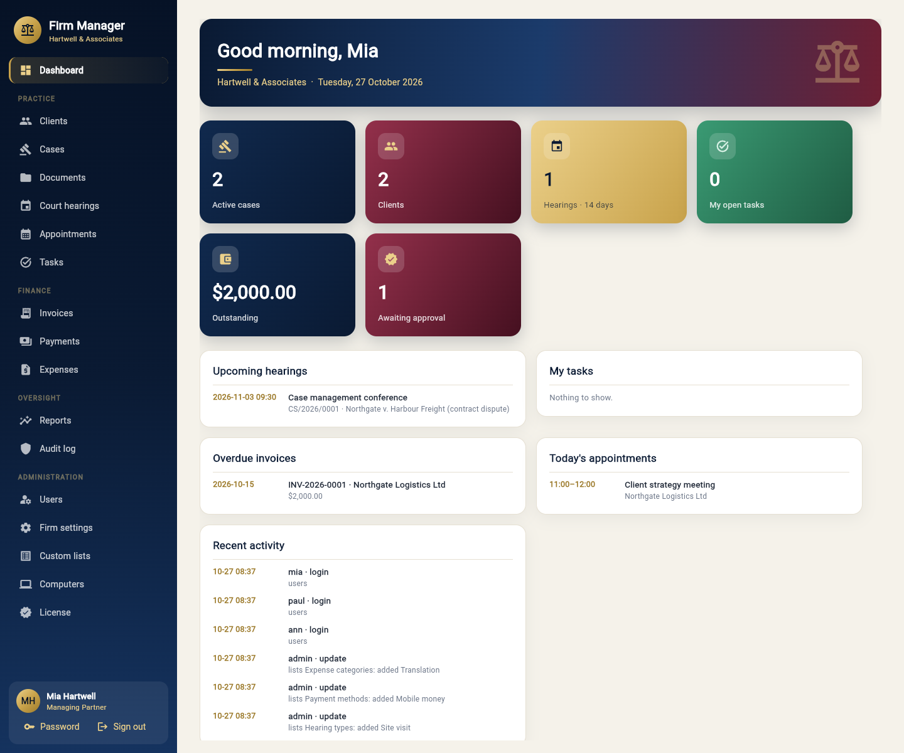

Every list page works the same way: a search box, filter buttons, a table, and small icons on each row (hover to see what each does). The gold button
at the top right adds a new record. Everything is saved on the server immediately, so a colleague sees your change the next time their page refreshes
(open the page again, or click a filter).

## 8. Clients and cases
**Clients** are people or companies the firm acts for. Add a client first, then open a case for them.

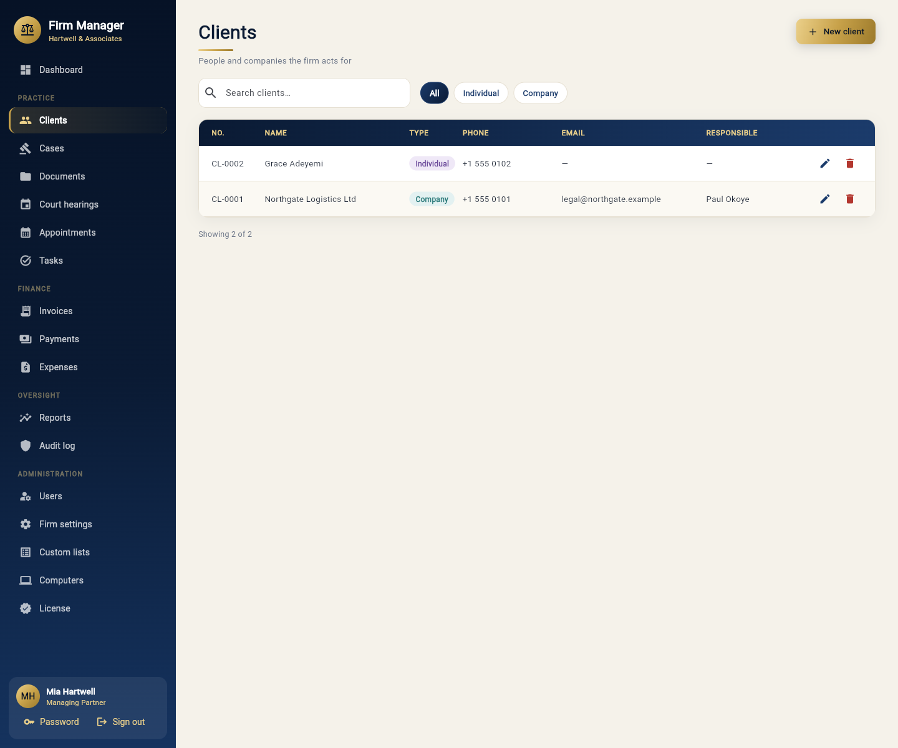

**Cases** (legal matters) hold the case number (for example `CS/2026/0001`, made automatically from your prefix), title, client, practice area, court details,
opposing party, lead lawyer, status, priority and fee arrangement.

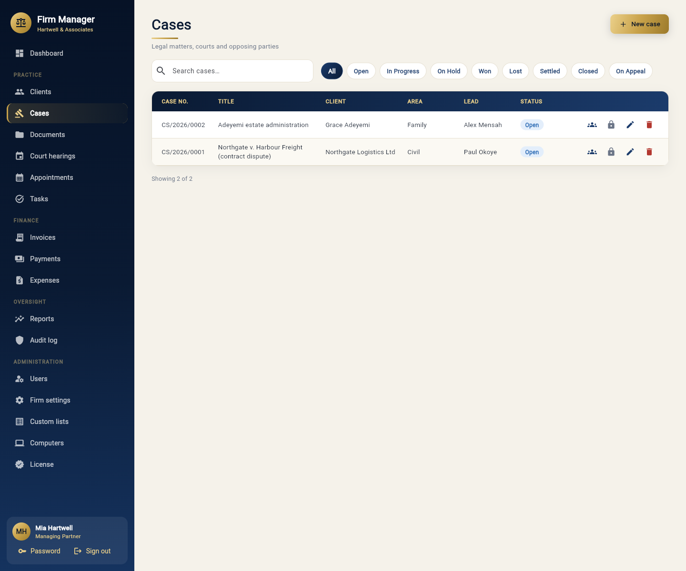

* **Case team** (the people icon on a row): add colleagues to the matter with a role. Who can see a case depends on the role (section 14).
* **Close case** (padlock) marks an open case as Closed and records the date. You can also set Won, Lost or Settled when you edit it.
* **Edit** changes a record; **Delete** removes it from the lists (it stays in the audit log).
* If a type or status you need is missing from a drop-down, add it under **Custom lists** (section 13).

## 9. Documents
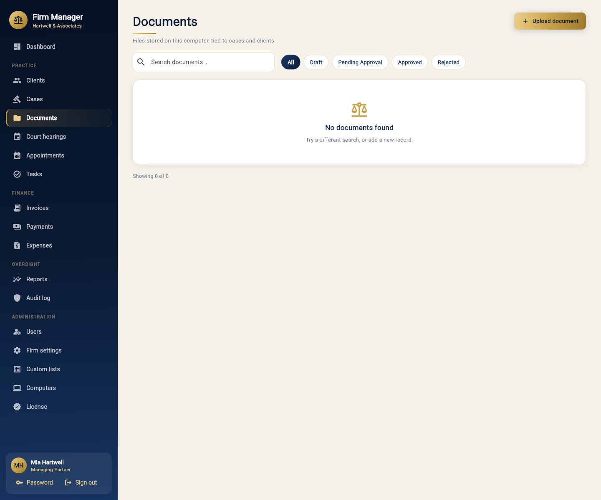

* **Add a document:** choose the file **on your own computer**, give it a title, a type, and tie it to a case and/or client. The file is sent to the central
  computer and stored there; the original on your computer is untouched. The largest file accepted is 200 MB.
* **Open** downloads a copy to a temporary folder on your computer and opens it with your usual program. **Save a copy…** saves it where you choose. The server
  checks the stored file has not been altered every time.
* Mark a document **Confidential** to restrict it to senior staff and the person who added it. The server enforces this for everyone.
* **Approval:** a draft can be *submitted for approval*; a partner approves or rejects it. Nobody approves their own submission unless their role may manage documents.

## 10. Diary and tasks
* **Court hearings:** date, time, court, courtroom, judge and type (Mention, Hearing, Trial, Ruling, Judgment, Case Management, Mediation, or your own types)
  with a status (Scheduled, Adjourned, Held, Cancelled). Upcoming ones appear on the dashboard.
* **Appointments:** meetings with clients and colleagues, with a status (Scheduled, Completed, Cancelled, No-show).
* **Tasks:** work items for the team with a due date, priority and the person they are assigned to. Use *Start*, *Mark done* and *Reopen*.

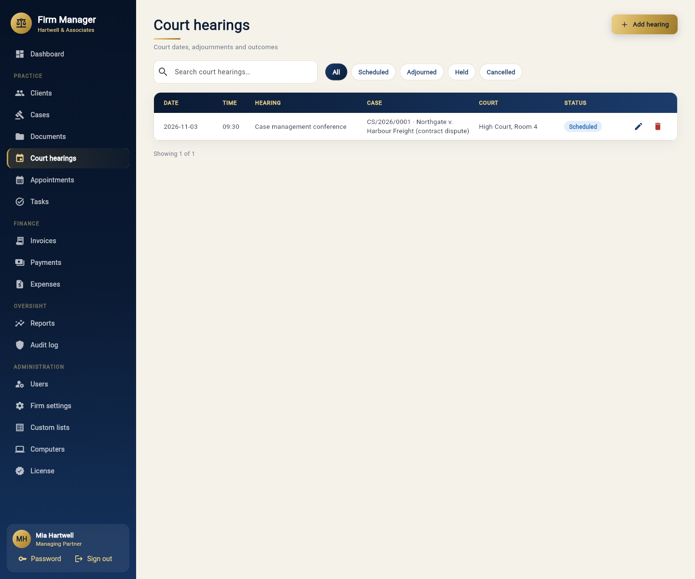

## 11. Billing
Billing is included in the **Solo, Chambers and Firm** plans (not Free).

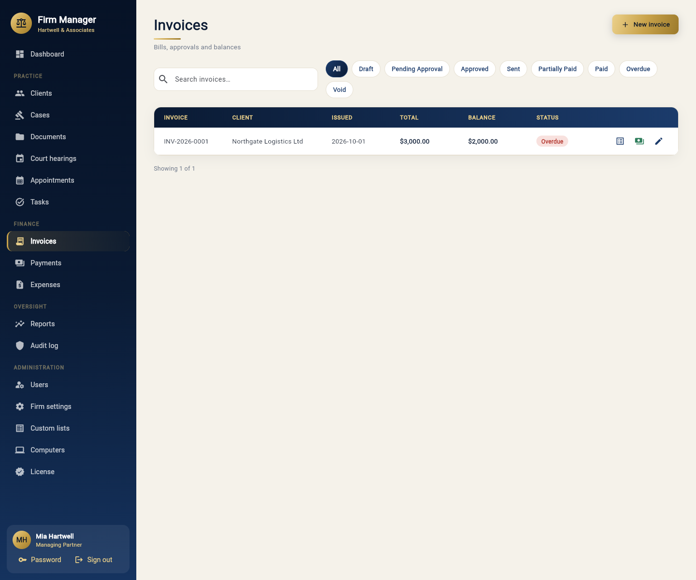

**Invoices** follow a controlled path: **Draft → Pending Approval → Approved → Sent → Paid**.
1. Create the invoice (client, case, dates, tax rate) and add **line items** (the list icon): description, quantity, unit price.
2. **Submit** it for approval (it needs at least one line). An approver **approves** it, or **rejects** it back to Draft for changes.
3. When approved, **Mark as sent to client**.
4. **Record payment** as money arrives. The invoice becomes *Partially Paid* then *Paid*; overdue invoices show on the dashboard.
5. **Void** cancels an invoice that has no payments. Only drafts can be edited; ask the approver to send it back if you need to change one.

**Payments** lists money received (amount, date, method). **Expenses** are costs paid on a matter: staff submit them, an approver approves or rejects.
The currency symbol, tax rate and invoice prefix come from Firm settings.

## 12. Reports and the audit log
**Reports** (Chambers and Firm plans) shows cases by status and practice area, caseload by lawyer, billing by month, receivables ageing, expenses by category
and hearings in the next 30 days. Each can be saved as a CSV file for a spreadsheet (saved on your own computer). Figures include only the records your role may open.

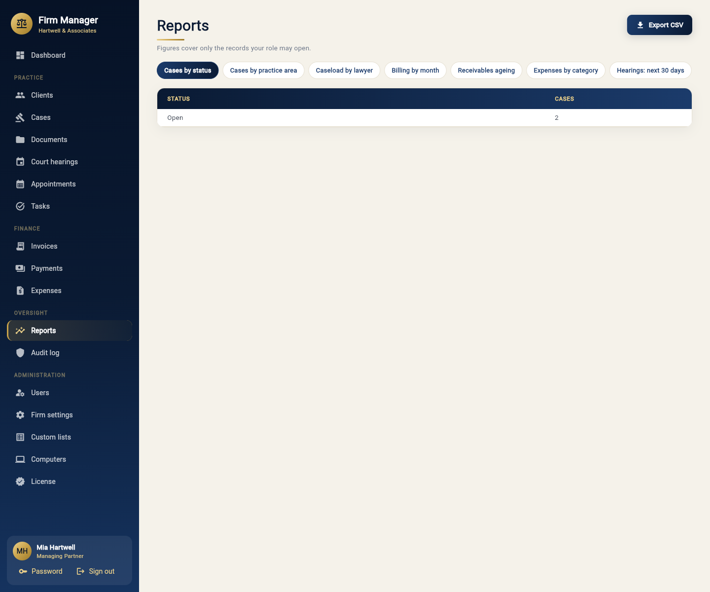

**Audit log** records every sign-in, change, approval and export, with who and when. It is chained so that editing or deleting entries is detectable; use
**Verify** to check it. The log and the document downloads are available on every plan.

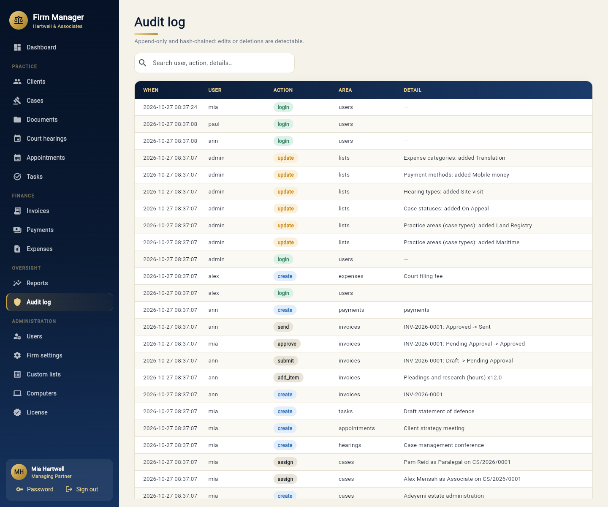

## 13. Settings and your own lists
**Firm settings** hold the firm's name, address, phone and email, currency symbol, default tax rate, case and invoice prefixes and backup options.

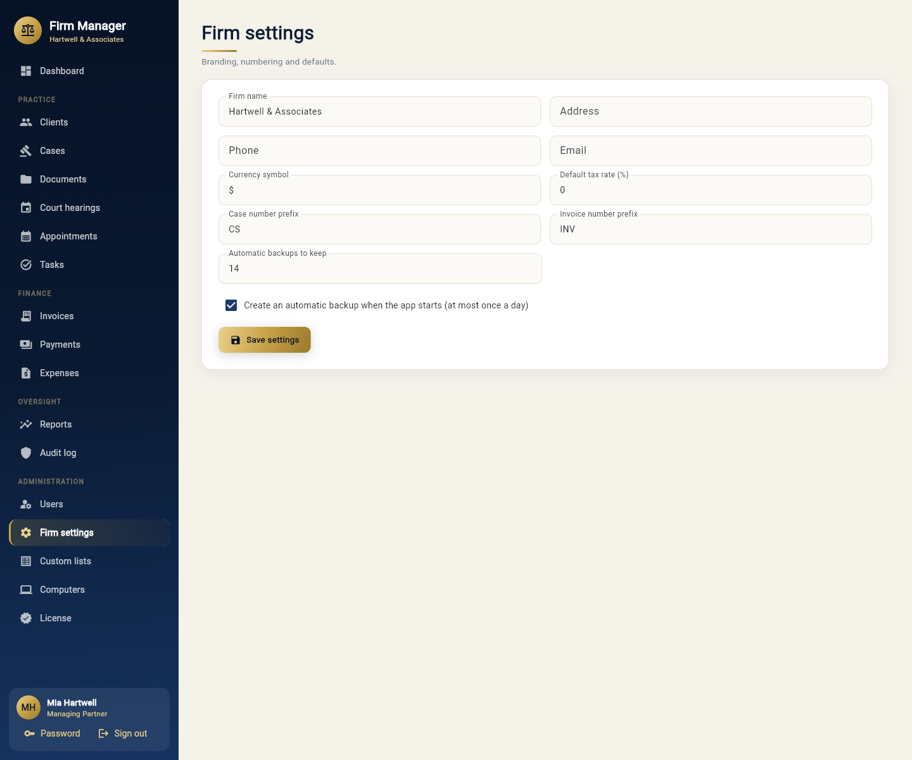

### Your own lists (case types, statuses, hearing types and more)
The drop-downs come with sensible built-in options, and **you can add your own**. Open **Custom lists** (System Administrator and Managing Partner).

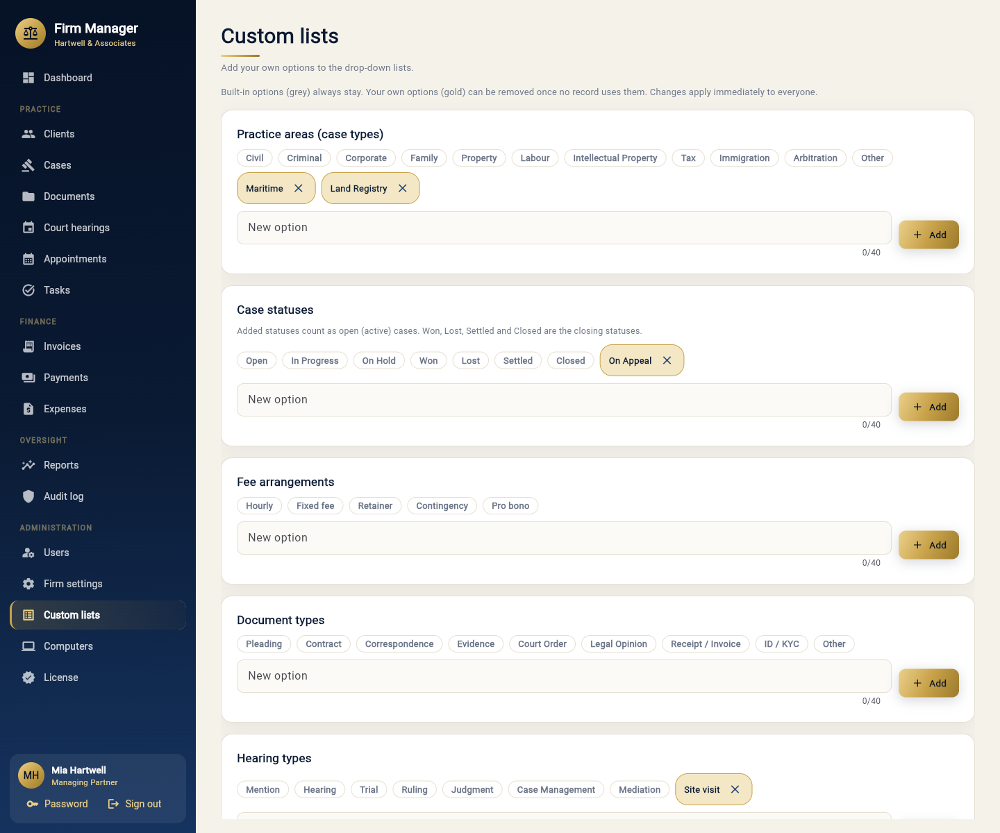

You can extend: **practice areas (case types), case statuses, fee arrangements, document types, hearing types, payment methods, expense categories** and
**roles on a case team**.
* Type the new option, then **Add**. It is available at once, **to everyone on every computer**.
* Built-in options (grey) stay for good. Your own (gold) can be removed with the ✕ **only when no record uses them**; the message tells you how many do.
* Options can be up to 40 characters, must differ from existing ones (capitals do not matter) and each list takes up to 50 of your own.
* A new **case status** counts as an *open* case; the **Close case** button still works from it. Won, Lost, Settled and Closed are the closing statuses.
* Not extendable, on purpose: hearing, appointment, task, invoice and expense statuses, and priority. The program's rules depend on them.

## 14. Users and roles
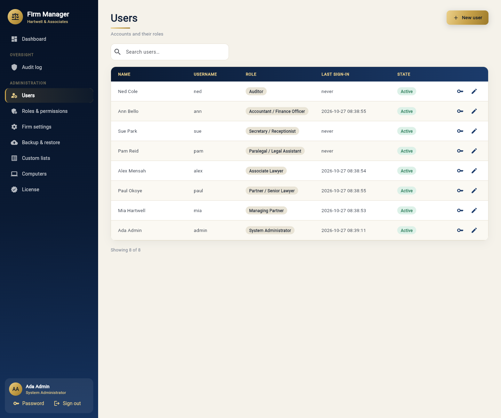

* **Users:** the System Administrator creates accounts, picks each person's role, **resets passwords** (the person must choose a new one at next sign-in),
  **unlocks** locked accounts and disables people who leave. A disabled account cannot sign in and frees its place on your plan's user limit.
* **Roles & permissions:** eight roles come ready-made. You can change what a role may do, or create your own; changes apply immediately.

| Role | What it is for |
|---|---|
| System Administrator | Users, roles, settings, backups, audit. **No access to client files by design.** |
| Managing Partner | Full control of the practice, including approvals. |
| Partner / Senior Lawyer | Own matters and teams; approves documents, invoices and expenses. |
| Associate Lawyer | Works on assigned matters; drafts documents; submits expenses. |
| Paralegal / Legal Assistant | Supports assigned matters: documents, hearings, tasks. |
| Secretary / Receptionist | Front desk: intake, diary and tasks. Cannot see confidential documents. |
| Accountant / Finance Officer | Billing, payments and expense approval across the firm. |
| Auditor | Read-only oversight of cases, finances and the audit log. |

Each role also has a **scope**: *firm-wide* or *assigned matters only* (cases they lead, are on the team of, or created), set separately for case/client/document data
and for money. Nobody can approve their own invoice, expense or document.

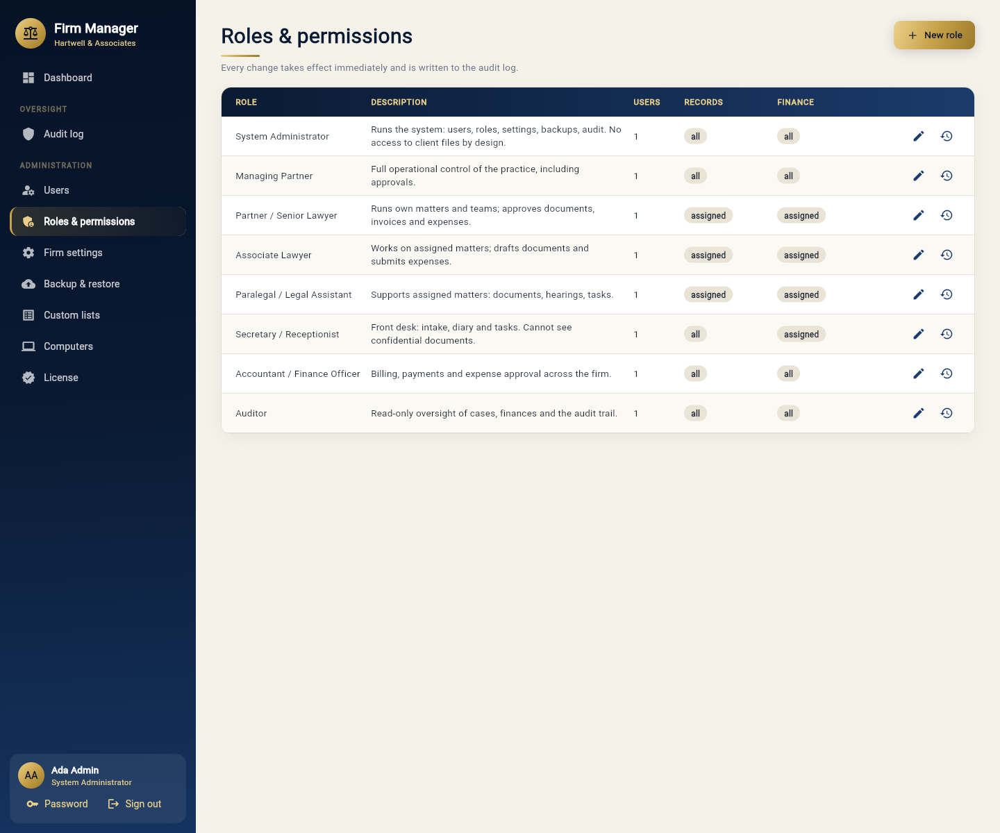

## 15. Computers
**Computers** (System Administrator and Managing Partner) shows which computers are connected to the server right now and lets you disconnect one.

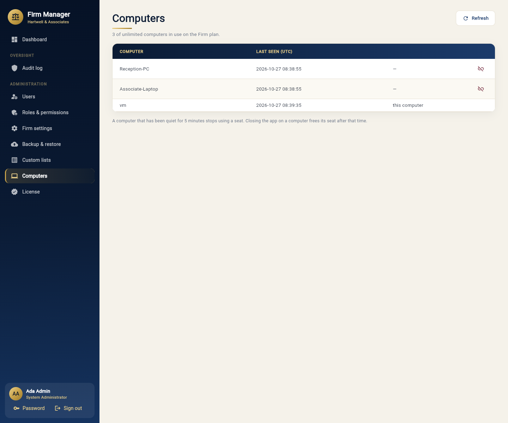

* A computer takes one of your plan's places **while someone is using it**, and for **5 minutes after the last use**. Closing Firm Manager frees the place after those
  5 minutes, or at once if you disconnect it here.
* **Disconnect** signs that computer out and frees its place. It can sign in again later if a place is free.
* Everyone on one computer shares that computer's single place: five people taking turns at one PC use one place.

## 16. Backups and restore
Backups are made and kept **on the central computer**. **Backup & restore** (System Administrator) shows them.

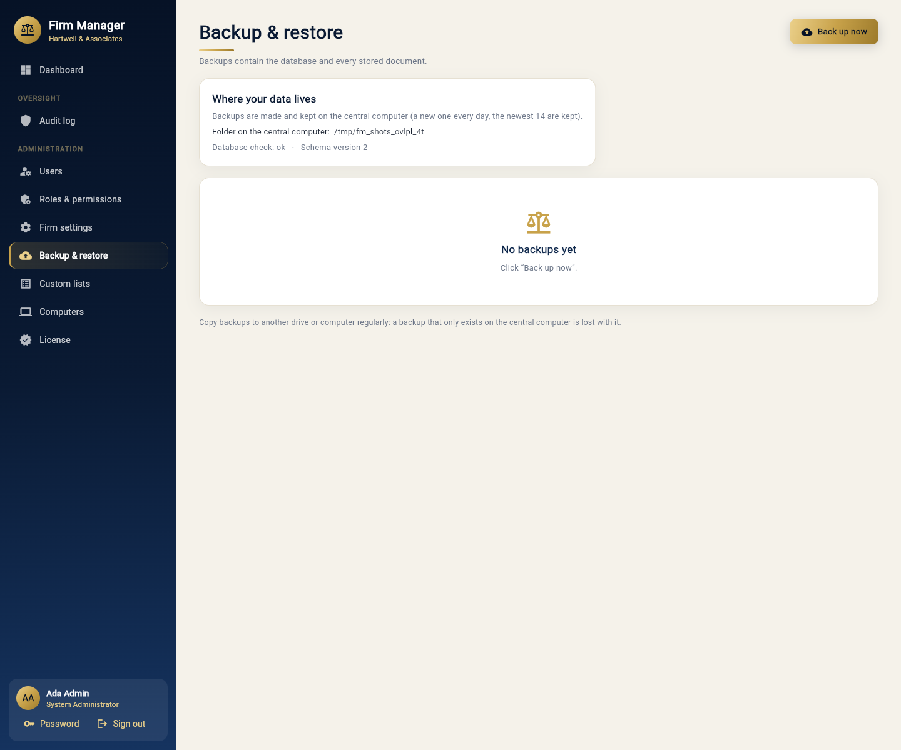

* A backup contains the database **and every stored document**.
* The server makes one **automatically every day** and keeps the newest 14. **Back up now** makes one immediately. A backup is also made automatically before
  any update that changes the database.
* **Restore** replaces the current data with the chosen backup **for everyone** (a safety copy is made first). Everyone is signed out and signs in again.
* **Copy backups to another drive or computer regularly.** A backup that exists only on the central computer is lost with it. On Windows the folder is
  `C:\ProgramData\FirmManager\backups`; on Linux `/var/lib/firmmanager/backups`. The central computer's **Computer ID** is not part of a backup: the licence belongs to the computer.
* If the central computer is lost: install the server on a new computer, restore a copied backup (below), and ask your vendor to re-issue the licence (section 19).

## 17. Licence and plans
The licence is installed **only on the central computer** and checked there. Open **License** (System Administrator or Managing Partner).

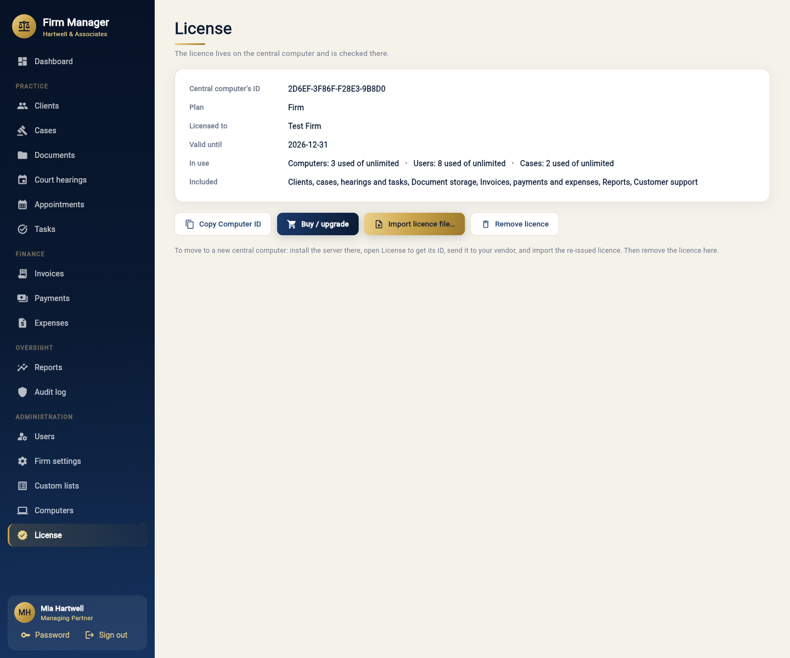

It shows the **central computer's ID**, your plan, who it is licensed to, when it ends and how much of each limit you are using.

| Plan | Computers at the same time | Users | Cases | Billing | Reports |
|---|---|---|---|---|---|
| Free | **1** | 2 | 25 | no | no |
| Solo | 2 | 3 | 500 | yes | no |
| Chambers | 8 | 15 | unlimited | yes | yes |
| Firm | unlimited | unlimited | unlimited | yes | yes |

Clients, cases, hearings, tasks, documents, the audit log, backups and support are in every plan. **Computers** counts the machines connected at the same time (section 15),
**Users** counts active accounts.

**To buy or upgrade:** open **License** on any client signed in as administrator and click **Buy / upgrade**. Your web browser opens the shop page with the central computer's ID.
Choose a plan and period (1, 2 or 3 years, or lifetime) and pay.

**To install the licence:** you receive a licence file (`.fmlicense`). On **License** click **Import licence file…** and choose it. The change applies at once, to every computer,
without restarting. **A licence works only on the central computer whose ID you gave.**

**When the computer limit is reached,** a computer that tries to sign in sees: *"Your plan allows N computers at the same time and N are already connected. Disconnect one or
upgrade your plan."* Disconnect one under **Computers**, wait 5 minutes, or upgrade.

**When a licence ends or is removed,** the server returns to the Free plan. **Your data is never deleted, hidden or locked**: you can still open and edit everything.
New records beyond the Free limits, billing and reports are paused with a message that says which. If you then have more computers connected than the Free plan allows,
the one that has been connected longest keeps working and the others are asked to wait until a place is free. A banner reminds the administrator 30 days before a licence ends.

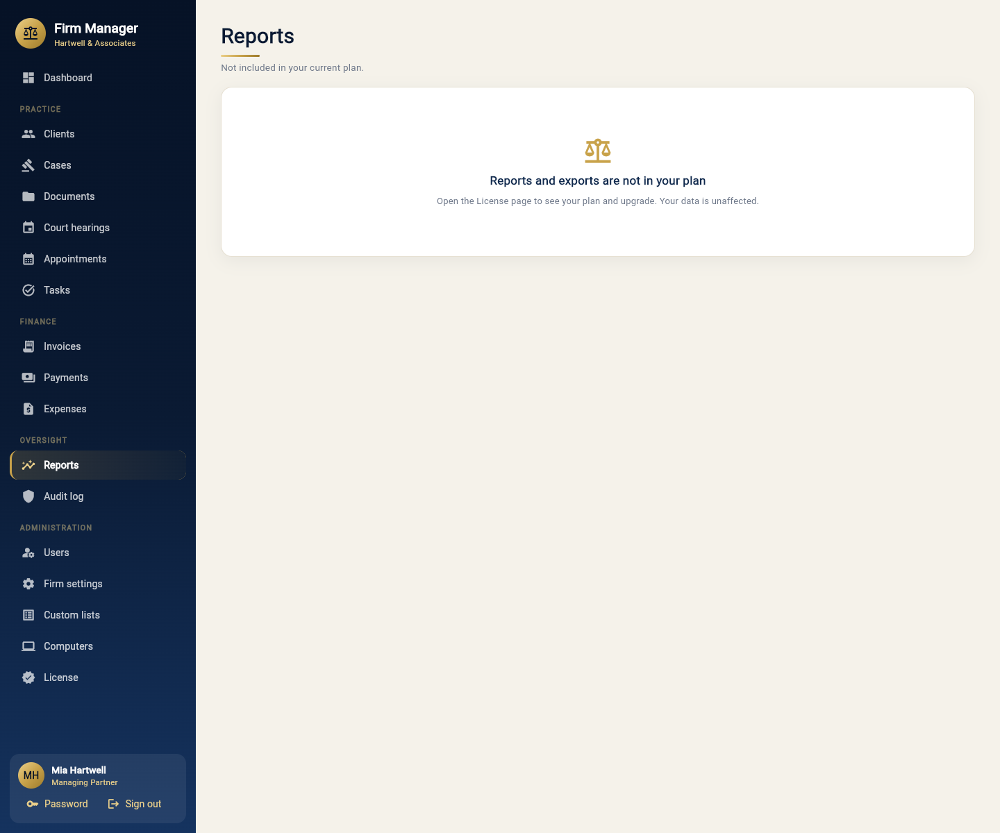

**Remove licence** returns the server to the Free plan (use it before moving the server). If the central computer's clock is set back, the server ignores that: the licence keeps counting from the latest date it has seen.

## 18. Updating
1. Make a backup (section 16).
2. Install the new **server** on the central computer. It keeps its data and licence, takes a safety copy and updates the database itself.
3. Then install the new **client** on each computer.
Server and clients must be the **same version**. A client that does not match shows "This computer needs an update" and cannot sign in until it is updated.

## 19. Moving the server to a new computer
1. On the **old** central computer: make a backup (section 16) and copy the backup file to a USB drive. Click **Remove licence**.
2. Install the **server** on the new computer (section 3). Note its address and **Computer ID**.
3. Send the new Computer ID to your vendor and ask for your licence to be **re-issued**.
4. On a client, connect to the new server (create the first administrator there, section 5), import the new licence, then **Restore** the backup: first copy the backup file
   into the new server's `backups` folder (section 16).
5. On every other computer choose **Use a different server** (or reinstall the client) and type the new address. Giving the new server the **old address** avoids this.

## 20. Coming from the single-computer version
If you used the earlier version where everything ran on one computer, your data can be moved to the server **without changing the original**:
1. Install the server, but **do not create the first administrator yet**. On the central computer open a terminal as administrator and run  
   `FirmManagerServer --import-db "C:\Users\YOU\AppData\Local\FirmManager" `  (Linux: `firmmanager-server --import-db ~/.local/share/firmmanager`)
   with the folder that holds the old `firmmanager.sqlite` and `documents`.
2. Install the client, connect to `127.0.0.1` and sign in with your old username and password (no new administrator is needed: your old accounts came across). The old folder is untouched; keep it until you are sure everything is there.
3. Old licences do not transfer: the licence belongs to the central computer. Ask your vendor to re-issue it.

## 21. Problems and answers
* **"Cannot reach the server."** Check: is the central computer on? Are you on the same office network? Is the address right? Open `http://ADDRESS:8000/health` in a browser:
  if it does not answer, the server is not running or something blocks it. Windows: check the *Firm Manager Server* task is running and the network is *Private*.
  Linux: `systemctl status firmmanager-server`. A firewall or antivirus on the central computer may block port 8000.
* **"The address changed."** The central computer got a new address. Give it a fixed one (section 2). On each client choose **Use a different server**.
* **"This computer needs an update."** Install the same version on this computer as on the central computer (section 18).
* **"Your plan allows N computers…"** See section 17: disconnect a computer, wait 5 minutes, or upgrade.
* **"Please sign in again."** The session ended (you were away, or the server restarted). Sign in again; nothing is lost.
* **"Your Free plan allows up to N users / cases" or "does not include …".** You reached a limit of your plan. Open **License** and upgrade. Existing data is unaffected.
* **A licence file is rejected.** It was issued for another computer, or the file was changed. Check the Computer ID you gave the vendor matches the one on **License**, and import the original file.
* **I forgot my password.** Ask the System Administrator to reset it. If the administrator forgot theirs, restore from a backup is the only way back in; keep the administrator password safe.
* **A drop-down is missing an option.** Add it under **Custom lists** (section 13).
* **The menu has fewer pages than a colleague's.** Pages follow the role. Ask the administrator to adjust the role.
* **Need help?** Email **fidelcmedia@gmail.com** (or message @Fidelcmedia on X, TikTok, Facebook, LinkedIn or YouTube). Say what you were doing, the message you saw, and your Firm Manager version.
* **Where are the server's logs?** `C:\ProgramData\FirmManager\logs\server.log` (Windows) or `/var/lib/firmmanager/logs/server.log` (Linux). Logs never contain passwords.

## 22. Safety notes
* This guide summarises how the program works. The **End-User Licence Agreement** (`EULA.txt`, shown when you install) is the binding text.
* **The connection between clients and the server is not encrypted.** Anyone who can plug into your office network or join your Wi-Fi could read the traffic. Use it only
  on a network you trust: a wired network or Wi-Fi with a strong password (WPA2/WPA3) and no guests. **Never** make the server reachable from the internet.
* Everything is still checked on the server: passwords are stored only as salted hashes, accounts lock after repeated failures, every action is audited, and the server refuses
  anything the person's role or your plan does not allow, whatever program or computer asks.
* The server's data folder holds client files. Keep the central computer physically safe, install system updates, and use a strong password for its own Windows/Linux account.
* Uninstalling never deletes the firm's data. To remove it for good, delete the data folder yourself after making a backup.
